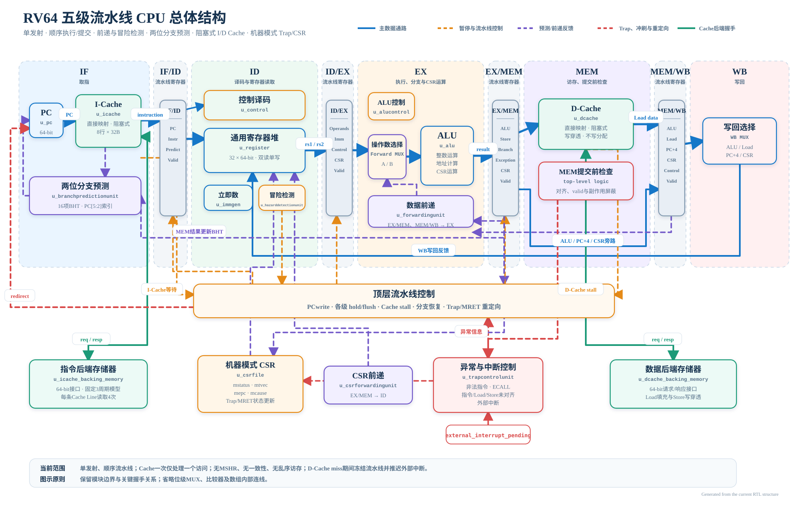

# RV64 五级流水线 CPU

这是一个使用 Verilog 实现的教学型 64 位 RISC-V 处理器。项目从单周期 CPU 逐步发展为单发射、顺序执行的五级流水线，并加入了数据前递、Load-use 冒险处理、两位动态分支预测、机器模式 CSR/Trap，以及阻塞式 I-Cache 和 D-Cache。

项目的重点不是覆盖完整 RISC-V 生态，而是从 RTL 层面理解一条指令如何经过取指、译码、执行、访存和写回，以及流水线如何处理数据相关、控制流变化、变长访存延迟和异常中断。

```text
单周期 CPU
    → 五级流水线
    → 前递与冒险检测
    → 动态分支预测
    → CSR 与异常中断
    → 阻塞式 I-Cache / D-Cache
```

当前版本已通过仓库内全部 **21 个 Icarus Verilog 回归测试**。

## 主要特性

- RV64 数据通路，五级流水线：IF、ID、EX、MEM、WB；
- 单发射、顺序执行、顺序提交；
- EX/MEM、MEM/WB 到 EX 的数据前递；
- Load-use 冒险检测、流水线暂停和气泡插入；
- 16 项两位饱和计数器 BHT，在 IF 阶段预测、MEM 阶段解析并恢复错误预测；
- JAL、JALR 和分支重定向时的年轻指令冲刷；
- 机器模式 CSR 读写、CSR 数据前递、ECALL 和 MRET；
- 非法指令、指令地址未对齐、Load/Store 未对齐和外部中断处理；
- 独立的直接映射阻塞式 I-Cache 与 D-Cache；
- D-Cache 采用 Write Through、Write Hit Update、No Write Allocate；
- 使用 `valid/ready` 请求握手和响应有效信号支持多周期存储访问；
- 自动回归脚本支持测试发现、单项测试、超时处理和日志保存。

## 总体架构



图中的蓝色路径表示主要数据流，橙色路径表示暂停和流水线控制，紫色路径表示预测与前递反馈，红色路径表示 Trap、冲刷和重定向，绿色路径表示 Cache 与后端存储器之间的握手。

架构图由 [`scripts/generate_architecture_diagram.py`](scripts/generate_architecture_diagram.py) 生成。Vivado 展开得到的完整 RTL 原理图也保存在 [`docs/generated`](docs/generated) 中，适合进一步检查模块实例和实际连线。

## 微架构概览

| 项目 | 当前实现 |
| --- | --- |
| 数据宽度 | 64 bit |
| 指令宽度 | 32 bit |
| 流水线 | IF / ID / EX / MEM / WB |
| 发射与提交 | 单发射、顺序执行、顺序提交 |
| 通用寄存器 | 32 × 64 bit，`x0` 恒为 0 |
| 数据相关处理 | EX/MEM 与 MEM/WB 前递，Load-use 暂停一个流水级周期后再继续 |
| 分支预测 | 16 项 BHT，每项为两位饱和计数器，复位为弱不跳转 |
| BHT 索引 | `PC[5:2]` |
| 控制流解析 | MEM 阶段解析分支、JAL、JALR、Trap 和 MRET |
| 存储访问 | 仅实现 64 位 `LD` / `SD`，要求 8 字节对齐 |
| 特权支持 | 部分机器模式 CSR 与 Trap 行为 |
| Cache | 分离式 I-Cache / D-Cache，直接映射、阻塞式 |

### 各流水级职责

| 流水级 | 主要工作 |
| --- | --- |
| IF | 通过 I-Cache 取指，读取 BHT 并计算预测目标地址 |
| ID | 指令译码、立即数生成、寄存器堆读取、CSR 读取和 Load-use 检测 |
| EX | ALU 运算、前递选择、访存地址计算、分支目标计算和 CSR 运算 |
| MEM | D-Cache 访问、控制流解析、Trap 判定及架构副作用有效性控制 |
| WB | 在 ALU、Load、U-type、PC+4 和 CSR 结果之间选择并写回寄存器堆 |

## 支持的指令

当前实现的是用于学习数据通路和控制逻辑的 **RV64 指令子集**，并不代表完整的 RV64I 实现。

| 类型 | 指令 |
| --- | --- |
| R-type 运算 | `ADD`、`SUB`、`AND`、`OR`、`XOR`、`SLT`、`SLL`、`SRL` |
| I-type 运算 | `ADDI`、`ANDI`、`ORI`、`XORI` |
| 访存 | `LD`、`SD` |
| 条件分支 | `BEQ`、`BNE` |
| 高位立即数 | `LUI`、`AUIPC` |
| 无条件跳转 | `JAL`、`JALR` |
| CSR | `CSRRW`、`CSRRS`、`CSRRC`、`CSRRWI`、`CSRRSI`、`CSRRCI` |
| 系统控制 | `ECALL`、`MRET` |

## 流水线控制

### 数据冒险

`ForwardingUnit` 比较 EX 阶段源寄存器与 MEM、WB 阶段目的寄存器，在结果已经产生时直接把较新的值送回 ALU 输入。MEM 阶段结果具有更高前递优先级。

Load 的数据必须等到存储访问完成后才能使用。若 ID 阶段指令依赖 EX 阶段的 Load，`HazardDetectionUnit` 会保持 PC 和 IF/ID，并向 ID/EX 注入气泡。检测逻辑结合译码产生的 `UseRs1`、`UseRs2`，避免把立即数字段误判为源寄存器。

### 分支预测与恢复

`BranchPredictionUnit` 使用 16 项 BHT，每项都是独立的两位饱和计数器：

- IF 阶段使用 `PC[5:2]` 读取预测方向；
- 分支立即数在 IF 阶段生成，用于计算预测目标；
- 预测结果和 BHT 索引随指令经过流水线；
- 分支在 MEM 阶段得到真实结果并更新 BHT；
- 预测错误时重定向 PC，并冲刷年轻指令。

JAL、JALR、Trap 和 MRET 同样在 MEM 阶段触发重定向。PC 选择逻辑对这些事件设置了明确优先级，其中 Trap 具有最高优先级。

## Cache 与可变延迟访存

I-Cache 和 D-Cache 都通过请求/响应接口与 CPU 和后端存储器交互：

```text
CPU 提交请求
    → Cache 检查 valid 与 tag
        → Hit：直接返回指令或数据
        → Miss：锁存请求并暂停相应流水线状态
              → 逐个读取后端 64-bit word
              → 填充完整 Cache Line
              → 完成原请求
              → 恢复流水线
```

### Cache 参数

| 参数 | I-Cache | D-Cache |
| --- | ---: | ---: |
| 映射方式 | 直接映射 | 直接映射 |
| Cache Line 数量 | 8 | 8 |
| 每条 Line 大小 | 32 B | 32 B |
| 总容量 | 256 B | 256 B |
| 后端数据宽度 | 64 bit | 64 bit |
| 每次填充传输次数 | 4 | 4 |
| 未完成请求数量 | 1 | 1 |
| 替换状态 | Valid + Tag | Valid + Tag |
| 写策略 | 只读 | Write Through |
| 写命中 | 不适用 | 同时更新命中 Cache Line |
| 写不命中 | 不适用 | No Write Allocate |

地址拆分采用：

```text
Tag        = address[63:8]
Index      = address[7:5]
Word       = address[4:3]       // 选择 Line 内的 64-bit word
I-Cache    = address[2]         // 选择 64-bit word 内的 32-bit 指令
D-Cache    = address[2:0]       // LD/SD 字节对齐检查
```

后端存储器模型包含 256 个 64 位 word，地址范围为 `0x000`～`0x7ff`，并用固定多周期响应模拟慢速存储器。

### I-Cache 取指

PC 作为 I-Cache 请求地址。命中时，指令在当前访问中返回；未命中时，I-Cache 锁存请求 PC 并完成整条 Cache Line 的填充。顶层同时记录未完成请求对应的 PC，只有响应仍与当前取指 PC 匹配时才允许指令进入 IF/ID，从而避免分支、跳转或 Trap 重定向后采用旧路径的迟到响应。

### D-Cache 访存

D-Cache 位于 MEM 阶段。Load miss 或等待 Store 后端确认期间，PC、IF/ID、ID/EX 和 EX/MEM 保持不变；Load 只有在 Cache 返回有效响应后才能进入 WB。Store 请求只在握手成功时接收一次，防止流水线等待期间重复写入。

为了保证 Trap 和访存副作用的关系明确，顶层会屏蔽发生 Trap 指令的寄存器、CSR 和存储器写入，并在 D-Cache 存在未完成请求时暂缓外部中断响应。

## CSR、异常与中断

当前实现以下机器模式 CSR：

| CSR | 地址 | 用途 |
| --- | --- | --- |
| `mstatus` | `0x300` | 保存 `MIE`、`MPIE` 中断状态 |
| `mtvec` | `0x305` | Trap 入口地址 |
| `mepc` | `0x341` | 保存 Trap 返回 PC |
| `mcause` | `0x342` | 保存 Trap 原因 |

当前检测的 Trap 原因包括：

| 原因 | `mcause` |
| --- | ---: |
| 指令地址未对齐 | `0` |
| 非法指令 | `2` |
| Load 地址未对齐 | `4` |
| Store 地址未对齐 | `6` |
| 机器模式 ECALL | `11` |
| 机器模式外部中断 | `0x8000_0000_0000_000b` |

Trap 在 MEM 阶段统一判定。进入 Trap 时保存 `mepc` 和 `mcause`、更新 `mstatus.MIE/MPIE` 并跳转到 `mtvec`；执行 `MRET` 时从 `mepc` 返回并恢复中断使能状态。CSR 相邻相关通过独立的 CSR 前递通路处理。

## 验证

项目使用自检查 Verilog testbench。回归脚本会发现 `tb/` 下所有 `*_tb.v`，为每个测试选择独立仿真顶层、编译全部 RTL、执行仿真，并把编译和运行日志保存到 `build/regression/`。

仓库中的 [GitHub Actions 工作流](.github/workflows/rtl-regression.yml) 会在每次推送、Pull Request 和手动触发时，于 Ubuntu 环境安装 Icarus Verilog 并执行同一套完整回归；如果测试失败，相关日志会作为工作流产物保留 7 天。

当前回归覆盖：

- 20 条基础整数、访存和控制流指令；
- EX/MEM、MEM/WB 前递和 Store 数据前递；
- Load-use、Load-to-Store 和伪相关排除；
- 分支预测状态变化、预测错误恢复、JAL/JALR 冲刷；
- CSR 读写、CSR 前递、ECALL、MRET；
- 非法指令、未对齐异常和外部中断；
- D-Cache 地址拆分、Hit/Miss、整行填充和 Store 写策略；
- I-Cache 冷启动 miss、跨行取指、重定向和迟到响应丢弃；
- I-Cache 与 D-Cache 同时等待时的整机流水线行为；
- D-Cache 未完成访问与外部中断之间的交互。

最近一次完整回归结果：

```text
Regression summary
  Total : 21
  Passed: 21
  Failed: 0
```

## 快速运行

### 环境要求

- Python 3；
- Icarus Verilog，且 `iverilog` 和 `vvp` 已加入 `PATH`；
- Vivado 不是运行回归测试的必要条件。

检查工具是否可用：

```bash
python --version
iverilog -V
vvp -V
```

运行全部测试：

```bash
python scripts/run_regression.py
```

列出测试：

```bash
python scripts/run_regression.py --list
```

运行指定测试：

```bash
python scripts/run_regression.py ICache_tb PIPELINED_CPU_CacheInteraction_tb
```

需要查看完整编译和仿真输出时加入 `--verbose`：

```bash
python scripts/run_regression.py --verbose
```

### 当前程序装载方式

测试平台直接初始化两个后端存储器模型。I-Cache 后端的每个 64 位 word 保存两条指令：低 32 位对应较低 PC，高 32 位对应下一条指令；D-Cache 后端则按 64 位数据组织。可以参考 [`tb/PIPELINED_CPU_tb.v`](tb/PIPELINED_CPU_tb.v) 中的 `write_instr` 任务。

当前尚未集成 ELF/HEX 自动加载器或 RISC-V 交叉编译工具链，因此运行自定义程序时需要先编码指令并写入测试平台。

## 仓库结构

```text
.
├── rtl/
│   ├── PIPELINED_CPU.v          # 五级流水线 CPU 顶层
│   ├── Cache/                   # I-Cache 与 D-Cache
│   ├── control/                 # 译码、冒险、前递、分支预测、CSR/Trap
│   ├── datapath/                # ALU、寄存器堆、PC、立即数生成
│   ├── memory/                  # 流水线寄存器与 Cache 后端存储器
│   └── legacy/single_cycle/     # 早期单周期实现
├── tb/                          # 当前模块与整机自检查测试
│   └── legacy/                  # 单周期 CPU 测试
├── scripts/
│   ├── run_regression.py        # 自动回归入口
│   └── generate_architecture_diagram.py
├── .github/workflows/            # GitHub Actions 自动回归
├── docs/
│   ├── images/                  # README 架构图与设计图
│   ├── generated/               # Vivado 展开的详细 RTL 原理图
│   ├── legacy/single_cycle/     # 单周期阶段的文档
│   └── 五周期流水线CPU代码编写日志.md
└── README.md
```

推荐按以下顺序阅读源码：

1. [`rtl/PIPELINED_CPU.v`](rtl/PIPELINED_CPU.v)：先建立完整数据通路和控制关系；
2. [`rtl/memory`](rtl/memory)：理解各级流水线寄存器如何保持、冲刷和传递 valid；
3. [`rtl/control`](rtl/control)：查看译码、冒险、前递、分支预测和 Trap；
4. [`rtl/Cache`](rtl/Cache)：查看阻塞式 Cache 的请求锁存、状态机和填充过程；
5. [`tb`](tb)：从自检查场景理解各项设计约束。

## 重新生成架构图

架构图使用 Python 标准库生成，不需要额外绘图库：

```bash
python scripts/generate_architecture_diagram.py
```

生成结果会写入：

```text
docs/images/pipelined-cpu-architecture.svg
```

## 当前范围与限制

- 只实现上表列出的 RV64 指令子集，尚未通过官方 RISC-V ISA compliance tests；
- 未实现乘除法、原子指令、压缩指令、浮点、虚拟内存和 MMU；
- 特权架构仅覆盖本项目所需的部分机器模式 CSR 与 Trap 行为；
- Cache 为直接映射阻塞式结构，每个 Cache 同时只允许一个未完成请求；
- 未实现 MSHR、非阻塞 Cache、一致性协议、乱序 Load/Store、写回和写分配；
- 当前顶层内置仿真后端存储器，尚未连接 AXI、片外内存控制器或 FPGA BRAM；
- 当前验证以 RTL 仿真为主，尚未给出 FPGA 时序、面积、功耗或 CoreMark 数据。

## 后续计划

- 增加汇编程序到存储器镜像的自动生成与装载流程；
- 扩展指令集并接入官方 ISA 测试；
- 将 Cache 后端接口暴露到顶层，并适配 FPGA BRAM 或标准总线；
- 增加周期、提交指令、Cache miss 和分支预测性能计数器；
- 在真实 FPGA 目标上完成综合、时序分析和程序运行；
- 在现有顺序流水线基础上继续学习双发射、记分牌、寄存器重命名、ROB、LSQ 和乱序执行。

## 开发文档

- [五周期流水线 CPU 代码编写日志](docs/五周期流水线CPU代码编写日志.md)
- [单周期 CPU 代码编写经验文档](docs/legacy/single_cycle/单周期CPU代码编写经验文档.md)
- [单周期 20 指令 CPU 代码编写日志](docs/legacy/single_cycle/单周期20指令CPU代码编写日志.md)

## 开源许可证

本项目采用 [MIT License](LICENSE) 开源。

