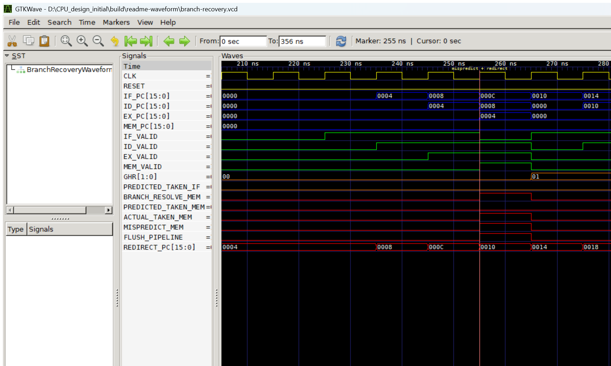

# RV64 RTL Architecture Lab

[English](README.md) · [RTL 回归](https://github.com/Ma-X-J/rv64-rtl-architecture-lab/actions/workflows/rtl-regression.yml)

这是一个用 Verilog 实现的 64 位、单发射、顺序执行 RISC-V CPU，用于 RTL 与计算机体系结构实验。



## 已实现内容

- IF/ID/EX/MEM/WB 五级流水线，以及前递、Load-use 暂停、流水线冲刷和错误预测恢复。
- RV64I 指令子集、当前 CoreMark 镜像需要的 RV64M 运算，以及自定义 `SUM2W` 指令。
- 可配置的 16 项双模 BHT、2 位 GHR 相关预测器和竞赛预测器。
- 机器模式 CSR、Trap/中断、`ECALL` 与 `MRET`。
- 独立的阻塞式直接映射 I-Cache、D-Cache，以及多周期后端存储器握手。
- Clang/LLVM 裸机编译流程、上游 CoreMark 功能移植和自定义 LLVM Pass 实验。
- 42 个自检查 Icarus Verilog 测试，覆盖单元、流水线、Cache、软件程序和 CoreMark。

这是教学型 CPU，并不是完整的 RV64IM 实现。作为通用 RISC-V 目标使用前，请先阅读[当前边界](#当前边界)。

## 实测结果

以下数据均来自当前 RTL，并包含 Cache 冷启动开销。

### 分支预测对比

三种模式运行完全相同的 4,096 条条件分支 RV64I 程序。

| 预测器 | 周期数 | CPI | 错误预测 | 准确率 |
|---|---:|---:|---:|---:|
| 16 项双模 BHT | 32,637 | 1.173 | 1,479 | 63.89% |
| 2 位 GHR 相关预测器 | 29,982 | 1.078 | 594 | 85.50% |
| 竞赛预测器 | **29,586** | **1.064** | **462** | **88.72%** |

在该受控程序中，竞赛预测器相比普通 BHT 将总周期降低 9.35%，错误预测数降低 68.76%。

### LLVM 循环优化实验

| `-O2` 版本 | 周期数 | 提交指令 | I-Cache miss |
|---|---:|---:|---:|
| 基线 | 240 | 66 | 5 |
| 手工二路展开 | 222 | 63 | 5 |
| 自定义 LLVM Pass 二路展开 | **222** | **63** | **5** |
| 四路展开 | 241 | 61 | 6 |

二路展开将周期降低 7.5%。四路展开虽然执行的指令更少，但多出一次 I-Cache miss，最终反而更慢。

### 验证状态

| 检查项 | 结果 |
|---|---|
| 完整 RTL 回归 | **42 / 42 通过** |
| 上游 CoreMark 功能运行 | **CRC 校验通过** |
| CoreMark RTL 仿真 | 1,137,169 周期；MEM 处观察到 319,615 条指令 |
| SUM2W LLVM 变换 | `transformed=1`；自定义指令编码检查通过 |

当前 CoreMark 使用固定的功能计时器。CRC 结果可以验证编译与执行链路，但它**不是可报告的正式 CoreMark 分数**。

## 如何复现

### 基本依赖

- Python 3
- Icarus Verilog（`iverilog`、`vvp`）
- 复现 README 波形图时需要 GTKWave
- 只有重新编译软件或 LLVM Pass 时才需要 PowerShell、Clang/LLVM 23 和 CMake

运行使用仓库内固定 HEX 的完整 RTL 回归：

```powershell
python .\scripts\run_regression.py
```

复现 README 顶部的分支预测错误恢复波形：

```powershell
& .\scripts\generate_readme_waveform.ps1
```

脚本会编译并自检短演示程序，生成
`build/readme-waveform/branch-recovery.vcd`，然后用仓库中固定的信号顺序、
颜色、标记和时间范围打开 GTKWave。若只生成 VCD 而不打开 GTKWave，添加
`-NoGui` 参数。

重新编译并运行 CoreMark 功能测试：

```powershell
& .\software\coremark\run.ps1
```

重新编译分支预测程序并比较三种模式：

```powershell
& .\software\branch_predictor_benchmark\build.ps1
& .\software\branch_predictor_benchmark\run.ps1 -PredictorMode 0
& .\software\branch_predictor_benchmark\run.ps1 -PredictorMode 1
& .\software\branch_predictor_benchmark\run.ps1 -PredictorMode 2
```

构建 SUM2W LLVM Pass 和生成程序：

```powershell
$env:LLVM_BIN = 'C:\path\to\complete-llvm\bin' # opt.exe 已在 PATH 时可省略
& .\scripts\llvm\build_sum2w_pass.ps1
python .\scripts\run_regression.py SUM2W_DECODE_ALU_tb SUM2W_PIPELINE_tb
```

所有生成物写入已忽略的 `build/`。RTL 回归所需 HEX 固定在 `tb/fixtures/`，所以普通回归不依赖本机 LLVM。

## 仓库结构

| 路径 | 内容 |
|---|---|
| `rtl/` | 当前流水线 RTL 与保留的单周期 RTL |
| `tb/` | 单元、集成、程序和旧版 TB，以及固定测试镜像 |
| `software/` | 裸机源码、链接脚本和构建命令 |
| `compiler/` | 自定义 LLVM Pass 源码 |
| `scripts/` | 回归、测试镜像、架构图、LLVM 与 Vivado 脚本 |
| `docs/` | 架构图、性能记录和开发日志 |
| `third_party/` | 上游 CoreMark 源码及许可证 |

## 当前边界

- ISA 是现有程序和测试覆盖到的子集，不代表完整 RV64IM 兼容。
- `DIVUW` 当前为组合逻辑，尚未作为可综合的高性能除法器进行时序验证。
- 特权支持是机器模式教学子集，并非完整 RISC-V 特权架构。
- 所有性能数据来自受控 RTL 仿真，不是芯片实测数据。

详细记录见 [CPU 性能基准](docs/benchmarks/CPU性能基准.md)、[LLVM 循环优化对比](docs/benchmarks/LLVM循环优化性能对比.md)和[开发日志](docs/development/五周期流水线CPU代码编写日志.md)。

## 许可证

项目代码使用 [MIT License](LICENSE)。仓库内 CoreMark 保留上游 Apache-2.0 许可证，详见[第三方说明](third_party/README.md)。
