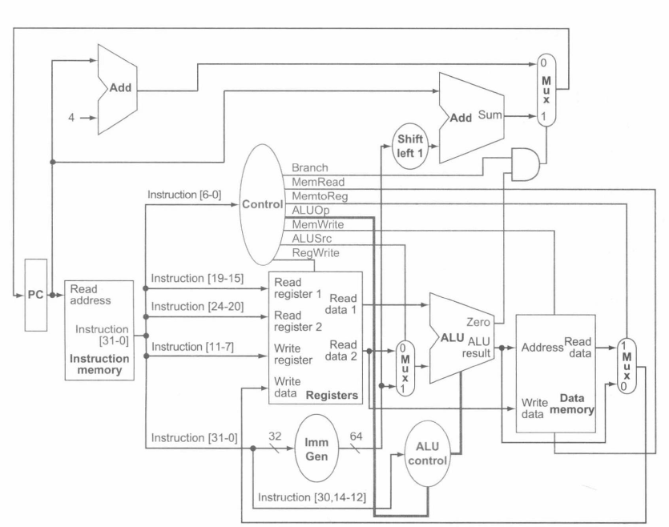

# 单周期 20 指令 CPU 代码编写日志（2026 年 9 月 21 日）

> 编写日期：2026 年 9 月 21 日  
> 对应工作：在前一版单周期 CPU 的基础上扩展至 20 条指令，并完成完整 testbench 验证。

## 一、今天工作的起点和最终结果

今天的工作建立在昨日完成的单周期 CPU 上。交流中一直把它简称为“5 指令 CPU”，但从实际 RTL 功能看，昨日版本已经支持：

- R 型：`add`、`sub`、`and`、`or`
- 访存：`ld`、`sd`
- 分支：`beq`

也就是已经有 7 条具体指令。今天在这套数据通路上新增了 13 条：

- R 型：`xor`、`slt`、`sll`、`srl`
- I 型运算：`addi`、`andi`、`ori`、`xori`
- 分支：`bne`
- U 型：`lui`、`auipc`
- 跳转：`jal`、`jalr`

最终支持的指令总数为 20 条：

| 类别 | 指令 |
| --- | --- |
| R 型寄存器运算 | `add sub and or xor slt sll srl` |
| I 型立即数运算 | `addi andi ori xori` |
| 访存 | `ld sd` |
| 条件分支 | `beq bne` |
| U 型 | `lui auipc` |
| 无条件跳转 | `jal jalr` |

今天没有推倒原来的 CPU 重写。主要做法是观察新指令与旧数据通路的共同部分，只在无法复用的地方增加控制信号、MUX 输入或 PC 选择路径。最终修改涉及：

- [Control.v](rtl/control/Control.v)：增加指令译码和新的控制信号。
- [ALUControl.v](rtl/control/ALUControl.v)：增加新 ALU 操作的译码。
- [ALU.v](rtl/datapath/ALU.v)：增加 XOR、有符号比较和移位运算。
- [Immgen.v](rtl/datapath/Immgen.v)：增加 I/U/J 型立即数生成。
- [CPU.v](rtl/CPU.v)：扩充 ALU 输入、写回和 NextPC 三处选择逻辑。
- [CPU_tb.v](tb/CPU_tb.v)：最终建立覆盖全部 20 条指令的自动检查。

[Register.v](rtl/datapath/Register.v)、[PC.v](rtl/datapath/PC.v)、[IR.v](rtl/memory/IR.v) 和 [DataMemory.v](rtl/memory/DataMemory.v) 的基本功能不需要为了这些新指令重新设计。这说明原来划分的寄存器堆、PC、指令存储器和数据存储器接口具有可复用性。

---

## 二、扩展前先形成的总体判断

增加一条指令时，不能只问“Control 里加一个 opcode 是否足够”，而要沿完整数据流依次检查：

1. **取指**：PC 从哪里来，执行后 NextPC 应该是什么。
2. **译码**：opcode、funct3、funct7 分别怎样区分这条指令。
3. **读寄存器**：是否使用 `rs1`、`rs2`，还是使用 PC。
4. **立即数**：属于 I、S、B、U、J 中哪一种格式，怎样拼接和符号扩展。
5. **执行**：ALU 的 A、B 两个输入各来自哪里，需要哪种 ALU 运算。
6. **访存**：是否读写 DataMemory。
7. **写回**：写回 ALU 结果、内存读数、立即数，还是 `PC+4`。
8. **PC 更新**：顺序执行、条件分支、JAL 或 JALR。

今天的结构性修改正好落在三个 MUX 上：

| 位置 | 原来的选择 | 扩展后的选择 |
| --- | --- | --- |
| ALU 的 A 输入 | 固定为 `readdata1` | `readdata1` 或 `current_pc`，由 `ALUASrc` 选择 |
| 寄存器写回数据 | ALU 结果或内存读数 | ALU 结果、内存读数、U 型立即数或 `PC+4`，由两位 `MemtoReg` 选择 |
| NextPC | `PC+4` 或条件分支目标 | 再加入 JAL 目标和 JALR 目标，由 `Jump`、`JumpReg` 和分支条件决定 |

这三个位置也是以后继续扩展指令时最值得先检查的地方。

---

## 三、今天采用的指令编码

| 指令 | opcode | funct3 | funct7 或其他区别 |
| --- | --- | --- | --- |
| `add` | `0110011` | `000` | `0000000` |
| `sub` | `0110011` | `000` | `0100000` |
| `and` | `0110011` | `111` | `0000000` |
| `or` | `0110011` | `110` | `0000000` |
| `xor` | `0110011` | `100` | `0000000` |
| `slt` | `0110011` | `010` | `0000000` |
| `sll` | `0110011` | `001` | `0000000` |
| `srl` | `0110011` | `101` | `0000000` |
| `addi` | `0010011` | `000` | I 型立即数 |
| `andi` | `0010011` | `111` | I 型立即数 |
| `ori` | `0010011` | `110` | I 型立即数 |
| `xori` | `0010011` | `100` | I 型立即数 |
| `ld` | `0000011` | `011` | I 型立即数 |
| `sd` | `0100011` | `011` | S 型立即数 |
| `beq` | `1100011` | `000` | B 型立即数 |
| `bne` | `1100011` | `001` | B 型立即数 |
| `lui` | `0110111` | 无 | U 型立即数 |
| `auipc` | `0010111` | 无 | U 型立即数 |
| `jal` | `1101111` | 无 | J 型立即数 |
| `jalr` | `1100111` | `000` | I 型立即数 |

今天一个重要认识是：**opcode 通常只能确定指令大类，不能总是确定具体操作。** 例如：

- `addi/andi/ori/xori` 的 opcode 全是 `0010011`，必须继续看 funct3。
- `beq/bne` 的 opcode 全是 `1100011`，必须继续看 funct3。
- `add/sub` 的 opcode 和 funct3 都相同，还必须继续看 funct7 中的关键位。

因此 [Control.v](rtl/control/Control.v) 的输入由只关注 opcode 改为接收完整的 32 位 `instruction`，顶层也相应改成：

```verilog
.instruction(instruction)
```

主控制器负责决定整条数据通路怎样走，ALUControl 再负责把 ALU 操作翻译成 4 位控制码。

---

## 四、按今天实际顺序逐条扩展

### 1. ADDI：第一次加入 I 型运算指令

`addi rd, rs1, imm` 的行为是：

```text
x[rd] = x[rs1] + sign_extend(imm)
```

例如 `addi x5, x2, -8`，ALU 的 A 输入为 `x2`，B 输入为符号扩展后的 `-8`，结果写回 `x5`。

它与原有 `add` 的共同部分是都使用 ALU 加法并把 ALU 结果写回寄存器。区别是：

- `add` 的 B 输入来自 `Readdata2`。
- `addi` 的 B 输入来自 Immgen。

因此旧数据通路里的 ALUSrc MUX 已经足够，不需要增加新 MUX。实际修改为：

- **Control**：识别 opcode `0010011` 和 funct3 `000`；设置 `ALUSrc=1`、`Regwrite=1`、`ALUOp=00`。
- **Immgen**：使用 I 型格式，将 `instruction[31:20]` 符号扩展到 64 位：

```verilog
{{52{instruction[31]}}, instruction[31:20]}
```

- **ALUControl**：`ALUOp=00` 直接产生 ADD 控制码 `0010`。
- **CPU 顶层**：原有 `ALUSrc ? instruction64 : readdata2` 已经能完成选择，不需要修改。

这里明确了负立即数仍然是加法。符号扩展后的 `-8` 以补码进入 ALU，执行 `A+B` 即可，不需要把 ADDI 改成减法。

### 2. ANDI：发现相同 opcode 还不够

`andi rd, rs1, imm` 执行：

```text
x[rd] = x[rs1] & sign_extend(imm)
```

它和 ADDI 一样使用 I 型立即数，所以 Immgen 不需要新增格式；差别只在 ALU 运算。此时遇到的问题是 ADDI 和 ANDI 的 opcode 都为 `0010011`，仅在 Control 中写一个 opcode 分支无法区分。

今天采用的解决方法是：

1. Control 接收完整 `instruction`。
2. 在 opcode 为 `0010011` 时继续判断 `instruction[14:12]`。
3. ADDI 的 funct3 为 `000`，ANDI 的 funct3 为 `111`。
4. ANDI 设置 `ALUOp=10`，让 ALUControl 进一步译码。
5. ALUControl 先按 opcode 区分 I 型和 R 型，再在 I 型分支内按 funct3 选择 AND。

之所以没有只把若干编码简单并在一起，是为了给后续 I 型和 R 型扩展保留清晰的层次。相同的 funct3 在不同 opcode 下可能代表不同类别，先判断 opcode 更容易维护。

### 3. ORI：复用 OR 运算

`ori rd, rs1, imm` 执行：

```text
x[rd] = x[rs1] | sign_extend(imm)
```

它与 ANDI 的数据通路完全相同，只有 funct3 和 ALU 功能不同：

- opcode：`0010011`
- funct3：`110`
- `ALUSrc=1`
- `Regwrite=1`
- `ALUOp=10`
- ALUControl 输出 OR 的控制码 `0001`

ALU 原来已经支持 OR，所以 [ALU.v](rtl/datapath/ALU.v) 不需要增加新的运算分支。

### 4. XORI：先给 ALU 增加 XOR 能力

`xori rd, rs1, imm` 执行：

```text
x[rd] = x[rs1] ^ sign_extend(imm)
```

编码为 opcode `0010011`、funct3 `100`。这条指令需要原 ALU 没有的 XOR 运算，因此今天为 XOR 分配了新的 4 位 ALU 控制码：

```text
0011 -> XOR
```

对应的 ALU 逻辑为：

```verilog
ALUResult = A ^ B;
```

Control、ALUControl 和 ALU 三层职责在这里表现得很清楚：

- Control 决定使用立即数、允许写回。
- ALUControl 根据指令字段生成 `0011`。
- ALU 只看到 `0011`，执行按位异或，不关心它来自 XORI 还是 XOR。

### 5. XOR：直接复用刚加入的 XOR 运算

`xor rd, rs1, rs2` 执行两个寄存器的按位异或。它是 R 型：

- opcode：`0110011`
- funct3：`100`
- funct7：`0000000`

原来的 R 型主控制信号已经是 `ALUOp=10`、`Regwrite=1`、`ALUSrc=0`，因此 Control 不用为 XOR 单独增加新数据通路。只需要：

- 在 ALUControl 的 R 型分支中把对应功能字段翻译成 `0011`。
- 复用 XORI 加入的 XOR 运算。

这说明多条指令可以共享同一个 ALU 控制码；指令译码与 ALU 运算实现不需要一一重复。

### 6. SLT：学习有符号比较

`slt rd, rs1, rs2` 的含义是“把两个寄存器按有符号数比较”：

```text
如果 x[rs1] < x[rs2]，x[rd] = 1
否则 x[rd] = 0
```

例如 `x1=-1`、`x2=1` 时，`slt x3,x1,x2` 得到 1。

最开始容易把它理解为“沿用 SUB，然后看结果”。减法确实可以作为硬件比较器的一部分，但在当前 Verilog 教学模型中，直接写有符号比较更清楚：

```verilog
ALUResult = ($signed(A) < $signed(B)) ? 64'd1 : 64'd0;
```

`A` 和 `B` 原本声明为无符号位向量，`$signed(...) `告诉 Verilog 本次比较按二进制补码解释。如果不转换，`64'hffff_ffff_ffff_ffff` 会被当成很大的正数，而不是 `-1`。

本次新增：

- ALU 控制码 `0100` 表示 SLT。
- ALUControl 在 R 型 funct3=`010` 时产生 `0100`。
- ALU 增加有符号小于比较。

### 7. SLL：逻辑左移

`sll rd, rs1, rs2` 将 `rs1` 左移，移位量来自 `rs2` 的低 6 位：

```text
x[rd] = x[rs1] << x[rs2][5:0]
```

可以用“乘以 2 的移位量次方”帮助理解数值变化，但硬件描述使用移位运算符：

```verilog
ALUResult = A << B[5:0];
```

RV64 的数据宽度为 64 位，只需要 6 位就能表示 0～63 的移位量，因此不能直接把完整 64 位 B 当作有效移位量。此次分配控制码 `0101`，R 型 funct3 为 `001`。

### 8. SRL：逻辑右移

`srl rd, rs1, rs2` 执行逻辑右移：

```verilog
ALUResult = A >> B[5:0];
```

它在左侧补 0，不保留符号。此次分配控制码 `0111`，R 型 funct3 为 `101`。

这里也顺便明确了以后实现 `sra` 时不能直接照搬：算术右移需要把操作数解释为有符号数并使用 `>>>`，而当前 `srl` 使用的是逻辑右移 `>>`。

### 9. BNE：复用减法和 Zero，修改分支判断

`bne rs1, rs2, offset` 的行为是：

```text
如果 x[rs1] != x[rs2]，NextPC = PC + offset
否则 NextPC = PC + 4
```

它和 BEQ 具有相同 opcode `1100011`，区别在 funct3：

- BEQ：`000`
- BNE：`001`

两者都让 ALU 做 `A-B`，因此不需要新增 ALU 运算：

- `Zero=1` 表示两个寄存器相等。
- BEQ 在 `Branch & Zero` 时跳转。
- BNE 在 `Branch & ~Zero` 时跳转。

CPU 顶层新增了：

```verilog
branch_and_zero     = Branch & zero;
branch_and_not_zero = Branch & ~zero;
```

然后根据 `instruction[14:12]` 判断 BEQ 或 BNE。由于 `next_pc` 开始在 `always @(*)` 中被赋值，它的声明从 `wire` 改为 `reg`。这里的 `reg` 只是 Verilog 过程赋值要求，并不表示又增加了一个 PC 寄存器；真正保存 PC 的时序单元仍然只有 [PC.v](rtl/datapath/PC.v)。

### 10. LUI：第一次扩充写回 MUX

`lui rd, imm20` 把 20 位立即数放到结果的高 20 位，低 12 位补零，再按 RV64 规则把 32 位结果符号扩展到 64 位：

```text
x[rd] = sign_extend({imm20, 12'b0})
```

例如：

```text
lui x5, 0x12345
x5 = 0x0000000012345000
```

LUI 不需要 DataMemory，也不需要 ALU 计算。旧写回 MUX 只有两种来源：

```text
ALUResult / MemoryReadData
```

现在必须增加第三种来源 `instruction64`。因此把 `MemtoReg` 从 1 位扩展为 2 位：

| MemtoReg | 写回数据 |
| --- | --- |
| `00` | `aluresult` |
| `01` | `mem_readdata` |
| `10` | `instruction64` |
| `11` | `pc_plus4`，后来供 JAL/JALR 使用 |

LUI 的修改包括：

- Immgen 增加 U 型立即数：

```verilog
{{32{instruction[31]}}, instruction[31:12], 12'b0}
```

- Control 设置 `MemtoReg=10`、`Regwrite=1`。
- CPU 将写回二选一改成四选一 `case`。

### 11. AUIPC：第一次扩充 ALU 的 A 输入

`auipc rd, imm20` 执行：

```text
x[rd] = current_pc + sign_extend({imm20, 12'b0})
```

例如该指令位于 `PC=4`，立即数为 `2`：

```text
U 型立即数 = 0x2000
写回结果 = 0x2000 + 4 = 0x2004
```

它与 LUI 使用相同 U 型立即数，但 LUI 直接写立即数，AUIPC 必须经过 ALU 加上当前 PC。原来的 ALU A 输入固定来自 `readdata1`，无法选择 PC，因此新建控制信号：

```text
ALUASrc = 0 -> readdata1
ALUASrc = 1 -> current_pc
```

CPU 中的 A 输入改为：

```verilog
.A(ALUASrc ? current_pc : readdata1)
```

AUIPC 的控制为：

- `ALUASrc=1`：A 选择当前 PC。
- `ALUSrc=1`：B 选择 U 型立即数。
- `ALUOp=00`：执行加法。
- `MemtoReg=00`：写回 ALU 结果。
- `Regwrite=1`。

这一条指令让我们认识到，MUX 的命名最好直接反映它控制哪个输入。这里采用 `ALUASrc`，与已有的 `ALUSrc` 区分 A、B 两端。

### 12. JAL：同时改变 PC 并写回 PC+4

`jal rd, offset` 同时做两件事：

```text
x[rd] = PC + 4
NextPC = PC + offset
```

它常用 `x1` 保存返回地址，但硬件并不强制目的寄存器必须是 `x1`，实际写入哪个寄存器由指令的 rd 字段决定。

JAL 的 J 型立即数字段分散在指令中。当前工程延续 BEQ 的设计方法：Immgen 先生成不带最低位 0 的 `imm[20:1]`，CPU 再统一左移一位。

Immgen 中的拼接为：

```verilog
{{44{instruction[31]}},
 instruction[31],
 instruction[19:12],
 instruction[20],
 instruction[30:21]}
```

顶层已有：

```verilog
branch_offset = instruction64 << 1;
branch_pc     = current_pc + branch_offset;
```

因此 JAL 可以复用 `branch_pc` 作为跳转目标。需要新增：

- Control 输出 `Jump`。
- JAL 时 `Jump=1`、`Regwrite=1`、`MemtoReg=11`。
- 写回 MUX 的 `11` 输入接 `pc_plus4`。
- NextPC 判断中让 JAL 选择 `branch_pc`。

这时才完整体现“PC+4 保存到 rd”：它不是 Jump 信号本身完成的，而是 `pc_plus4 → MemtoReg=11 → writedata → Register` 这条写回路径完成的。

### 13. JALR：寄存器基址跳转并清零最低位

`jalr rd, imm(rs1)` 同样写回 `PC+4`，但目标地址的计算方式不同：

```text
x[rd] = PC + 4
NextPC = (x[rs1] + sign_extend(imm)) & ~1
```

例如 `x5=100`、立即数为 9：

```text
ALUResult = 100 + 9 = 109
二进制最低位为 1
JALR 清除最低位后，NextPC = 108
```

JALR 使用 I 型立即数，因此扩展方式与 ADDI 相同：

```verilog
{{52{instruction[31]}}, instruction[31:20]}
```

新增的数据流和控制为：

- ALU A 输入取 `readdata1`。
- ALU B 输入取 `instruction64`，所以 `ALUSrc=1`。
- ALU 执行加法，所以 `ALUOp=00`。
- 新增 `JumpReg` 信号，区别于 JAL 的 `Jump`。
- 由 ALU 结果形成：

```verilog
jalr_pc = {aluresult[63:1], 1'b0};
```

- `MemtoReg=11`、`Regwrite=1`，把 `PC+4` 写回 rd。

JAL 使用“当前 PC + J 型偏移”，JALR 使用“寄存器值 + I 型立即数”。二者都写返回地址，但不能共用同一条目标地址计算路径。

---

## 五、各模块相比基础版发生了什么

### 1. Control.v

基础版只需按 opcode 分辨 R 型、LD、SD 和 BEQ。扩展后做了这些改变：

- 输入从局部 opcode 扩展为完整 32 位 `instruction`。
- I 型 opcode `0010011` 内继续按 funct3 区分 ADDI、ANDI、ORI、XORI。
- 分支 opcode `1100011` 同时服务 BEQ 和 BNE，具体条件留给 CPU 顶层判断。
- 新增 LUI、AUIPC、JAL、JALR 四个 opcode 分支。
- `MemtoReg` 从 1 位扩展为 2 位。
- 新增 `ALUASrc`、`Jump`、`JumpReg`。
- 每次组合译码开始时仍先给所有输出安全默认值，避免产生锁存器和误写。

当前各类指令的关键控制信号可以概括为：

| 指令类别 | ALUASrc | ALUSrc | ALUOp | MemRead | MemWrite | MemtoReg | Regwrite | Branch/Jump |
| --- | ---: | ---: | --- | ---: | ---: | --- | ---: | --- |
| R 型 | 0 | 0 | 10 | 0 | 0 | 00 | 1 | 无 |
| ADDI | 0 | 1 | 00 | 0 | 0 | 00 | 1 | 无 |
| ANDI/ORI/XORI | 0 | 1 | 10 | 0 | 0 | 00 | 1 | 无 |
| LD | 0 | 1 | 00 | 1 | 0 | 01 | 1 | 无 |
| SD | 0 | 1 | 00 | 0 | 1 | 00 | 0 | 无 |
| BEQ/BNE | 0 | 0 | 01 | 0 | 0 | 00 | 0 | Branch=1 |
| LUI | 无关 | 无关 | 无关 | 0 | 0 | 10 | 1 | 无 |
| AUIPC | 1 | 1 | 00 | 0 | 0 | 00 | 1 | 无 |
| JAL | 无关 | 无关 | 无关 | 0 | 0 | 11 | 1 | Jump=1 |
| JALR | 0 | 1 | 00 | 0 | 0 | 11 | 1 | JumpReg=1 |

### 2. ALUControl.v

基础版主要根据 `ALUOp` 和 R 型功能位生成 ADD、SUB、AND、OR。扩展后：

- `ALUOp=00` 仍统一表示 ADD，供 LD、SD、ADDI、AUIPC、JALR 使用。
- `ALUOp=01` 仍表示 SUB，供 BEQ/BNE 比较使用。
- `ALUOp=10` 时先判断 opcode：
  - opcode=`0010011`：译码 ANDI、ADDI、ORI、XORI。
  - opcode=`0110011`：译码 8 条 R 型指令。
- 未识别组合保持默认 `1111`，ALU 对应输出 0。

当前 ALU 控制码为：

| ALUControl | 运算 |
| --- | --- |
| `0000` | AND |
| `0001` | OR |
| `0010` | ADD |
| `0011` | XOR |
| `0100` | 有符号 SLT |
| `0101` | SLL |
| `0110` | SUB |
| `0111` | SRL |

当前 R 型译码延续教材数据通路的简化方式，实际使用
`{instruction[30], instruction[14:12]}`，没有检查完整的 7 位 funct7。
这足以区分目前支持的 8 条 R 型指令，但还不等同于完整的非法指令检测。
以后增加更多 R 型编码或异常处理时，应把完整 funct7 的合法性检查补上。

### 3. ALU.v

基础版已有 AND、OR、ADD、SUB 和 Zero。今天新增：

- XOR：`A ^ B`
- SLT：`($signed(A) < $signed(B)) ? 1 : 0`
- SLL：`A << B[5:0]`
- SRL：`A >> B[5:0]`

`Zero` 的生成方式没有变化，仍由 `ALUResult == 0` 得到，因此 BEQ 和 BNE 都能复用减法结果。

### 4. Immgen.v

基础版已有 LD 的 I 型、SD 的 S 型和 BEQ 的 B 型立即数。今天新增或复用：

| 指令 | 立即数处理 |
| --- | --- |
| ADDI/ANDI/ORI/XORI | 复用 I 型 `instruction[31:20]` 的 64 位符号扩展 |
| LUI/AUIPC | U 型：`instruction[31:12]` 后接 12 个 0，再符号扩展到 64 位 |
| JAL | 拼出 J 型 `imm[20:1]`，符号扩展，最低位由 CPU 左移补出 |
| JALR | 复用 I 型符号扩展 |

要特别记住：当前工程中 B 型和 J 型的左移 1 位都在 CPU 顶层完成。若以后把最低位 0 直接拼进 Immgen，就必须删除顶层的对应左移，不能两边同时做。

### 5. CPU.v

CPU 顶层的主要新增内容为：

1. Control 实例接收完整指令。
2. ALU 的 A 输入增加 `ALUASrc` MUX，以支持 AUIPC。
3. `MemtoReg` 改为两位，写回来源扩展为四种。
4. 增加 `branch_and_not_zero`，支持 BNE。
5. 增加 `Jump` 和 `JumpReg`。
6. 增加 `jalr_pc={aluresult[63:1],1'b0}`。
7. `next_pc` 改为在组合 `always` 块中赋值，并形成以下优先关系：

```text
JAL
  -> branch_pc
否则 JALR
  -> jalr_pc
否则 BEQ/BNE 条件成立
  -> branch_pc
否则
  -> pc_plus4
```

当前 Control 保证 `Jump`、`JumpReg`、`Branch` 不会为同一条合法指令同时有效，因此这一级优先选择可以正常工作。

### 6. 未修改的模块

- **Register**：仍然是两个组合读口、一个上升沿写口；新增指令只是改变写回数据来源。
- **PC**：仍然只负责在上升沿保存 NextPC；跳转复杂度全部放在 CPU 顶层的组合逻辑中。
- **IR**：仍通过 `CurrentPC[9:2]` 选择 32 位指令；支持更多指令不代表要增加更多 ROM。
- **DataMemory**：只有 LD/SD 使用它，新 ALU、U 型和跳转指令不会改变其结构。

---

## 六、最终 testbench 是怎样验证 20 条指令的

在完成 RTL 后，今天把 [CPU_tb.v](tb/CPU_tb.v) 扩展成了永久回归测试。测试平台没有手工为每条指令计算完整的 32 位十六进制机器码，而是编写了：

- `enc_r`
- `enc_i`
- `enc_s`
- `enc_b`
- `enc_u`
- `enc_j`

这些函数按 RISC-V 字段格式拼出机器码。这样测试某条指令时可以直接给出 funct、寄存器编号和立即数，减少人工抄写机器码的错误。

测试还定义了：

- `start_phase`：复位 PC，并清空寄存器、数据存储器和指令 ROM。
- `step`：等待一个有效时钟上升沿。
- `check_reg`：自动检查某个寄存器的最终值。
- `check_pc`：自动检查跳转后的 PC。
- `$fatal`：任何结果不符合预期时立即终止并报告实际值与期望值。
- 超时保护：CPU 未在规定时间内完成测试时主动报错。

全部测试分为六组：

1. **R 型组**：验证 `add/sub/and/or/xor/slt/sll/srl`。
2. **I 型组**：验证 `addi/andi/ori/xori`，包括负立即数。
3. **访存组**：验证 LD 读回和 SD 实际写入内存。
4. **分支组**：分别验证 BEQ/BNE 的跳转与不跳转，并确认被跳过的指令没有执行。
5. **U 型组**：验证 LUI/AUIPC，并检查最高位为 1 时的 RV64 符号扩展。
6. **跳转组**：验证 JAL/JALR 的正负偏移、`PC+4` 链接地址以及 JALR 对目标地址最低位的清零。

实际使用 Icarus Verilog 编译并运行后，最终输出：

```text
[PHASE] R-type ALU instructions
[PHASE] I-type ALU instructions
[PHASE] load and store
[PHASE] conditional branches
[PHASE] LUI and AUIPC
[PHASE] JAL and JALR

PASS: all 20 supported instructions passed.
```

编译器只报告了模块未统一设置 `timescale` 以及组合逻辑读取数组时的敏感列表提示，没有功能性编译错误。20 条指令的回归测试全部通过。

---

## 七、今天遇到的关键问题和形成的经验

### 1. 同一 opcode 下继续看 funct3

ADDI 与 ANDI、BEQ 与 BNE 都证明了 opcode 只表示大类。以后加指令时应先查完整编码表，依次确认 opcode、funct3 和 funct7，而不是只复制一个 opcode 分支。

### 2. 主控制与 ALUControl 分工

Control 解决“数据走哪条路、是否写回、是否访存、是否跳转”；ALUControl 解决“ALU 具体做哪种运算”。把全部判断堆在一个模块里虽然也可能运行，但会让后续扩展越来越难检查。

### 3. 新指令先找能复用的旧路径

- ADDI 复用 LD/SD 的“寄存器 + 立即数”ALU 输入。
- ANDI/ORI/XORI 复用同一个 I 型立即数。
- XOR 和 XORI 复用同一个 ALU 操作。
- BNE 复用 BEQ 的减法和分支目标加法器。
- JAL 复用分支目标的“PC + 左移偏移量”。
- JALR 复用 ADDI 的“寄存器 + I 型立即数”。
- JAL 与 JALR 复用同一个 `PC+4` 写回入口。

先寻找这些共同点，能避免为每条指令单独搭一套重复硬件。

### 4. 判断是否真的需要新控制信号

只有旧 MUX 无法表达新的输入来源时才新增控制：

- AUIPC 需要 PC 进入 ALU A 端，所以增加 `ALUASrc`。
- JAL 需要无条件选择 PC 相对目标，所以增加 `Jump`。
- JALR 的目标来自 ALU，和 JAL 不同，所以增加 `JumpReg`。
- LUI、JAL、JALR 带来新的写回来源，所以扩宽 `MemtoReg`。

### 5. 立即数要区分“编码形式”和“最终数值”

B 型和 J 型指令最低位天然为 0。当前工程选择在 Immgen 中生成去掉最低位的形式，再由 CPU 左移一位。只要模块边界约定一致，这种实现可以工作；最危险的是忘记左移或重复左移。

### 6. `reg` 不等于硬件寄存器

`next_pc` 改成 `reg` 是因为它由 `always @(*)` 赋值。这个改变不会增加时序级，也不会影响其他指令的周期数。是否形成真正的寄存器，要看赋值是否发生在 `posedge/negedge` 时序块中。

### 7. 写回与跳转是两条同时发生的数据流

JAL/JALR 不只是“修改 NextPC”。它们还必须把当前指令的 `PC+4` 写入 rd。调试跳转指令时必须同时检查：

- 新 PC 是否正确。
- rd 中的返回地址是否正确。

只检查其中一个会漏掉一半功能。

### 8. 编译通过之后还要验证语义

端口连接、位宽和语法正确只能保证代码能建立模型。今天最终测试还特意覆盖了：

- SLT 的负数比较。
- SLL/SRL 的 64 位移位量截取。
- BEQ/BNE 的 taken 和 not-taken。
- U 型立即数最高位为 1 时的符号扩展。
- JAL 的正负 PC 相对偏移。
- JALR 的正负立即数和最低位清零。

这些边界测试比只运行一条正常的正数指令更能证明数据通路确实正确。

---

## 八、当前 20 指令单周期 CPU 的整体数据流

可以把现在的 CPU 概括为：

```text
PC
 ├─> IR ─> instruction
 │          ├─> Control
 │          ├─> ALUControl
 │          ├─> Immgen
 │          └─> Register addresses
 │
 ├─> PC+4 ───────────────────────────────┐
 ├─> PC + branch/jump offset ─> branch_pc│
 │                                      │
Register ─> readdata1 ─┐                 │
                       ├─> ALU ─> result ├─> NextPC selection
PC ────────────────────┘                 │
                                          │
Register/Immgen ─> ALU B                  │
                                          │
ALU result ─> DataMemory                  │
     │             │                      │
     └─────────────┴─> write-back MUX <───┘
                         ├─ ALU result
                         ├─ memory data
                         ├─ U immediate
                         └─ PC+4
```

虽然图中出现 IF、ID、EX、MEM、WB 五个功能阶段，当前仍是**单周期 CPU**：一条指令在一个时钟周期内走完整条组合路径，只在 PC、寄存器堆写口和数据存储器写口处体现时序更新。下一步改成五级流水线时，才会在这些阶段之间加入 IF/ID、ID/EX、EX/MEM、MEM/WB 流水寄存器，并开始处理数据冒险、控制冒险和前递。
